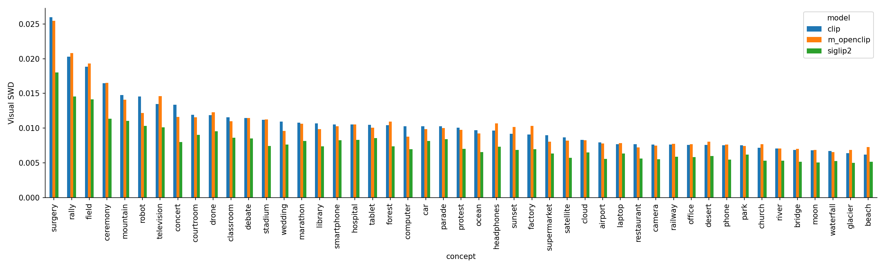
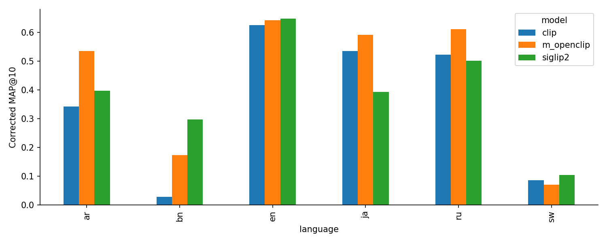

# Temporal Drift in Visual Embedding Spaces

## Table of contents

- [Overview](#overview)
- [Results](#results)
  - [Run and dataset](#run-and-dataset)
  - [H1: Concept-tier drift](#h1-concept-tier-drift)
  - [H2: Cross-lingual asymmetry](#h2-cross-lingual-asymmetry)
  - [H3: Trajectory consistency](#h3-trajectory-consistency)
  - [Photographic controls and model agreement](#photographic-controls-and-model-agreement)
  - [Retrieval quality](#retrieval-quality)
  - [Figures and interpretation limits](#figures-and-interpretation-limits)
- [Quick start](#quick-start)
- [Research runs](#research-runs)
- [Organization](#organization)
- [Outputs](#outputs)
- [Verification](#verification)
- [License](#license)

## Overview

A modular research framework for temporal probing of frozen multilingual
vision-language models. The reference experiment covers 48 concepts, six languages,
three periods (2004–2007, 2008–2011, 2012–2014), and CLIP, multilingual OpenCLIP,
and SigLIP-2.

**Authors:** Md Zunayedul Islam and Dr. Marcos Escudero-Viñolo,
Universidad Autónoma de Madrid.

The original 48-concept notebook (`t-Drift-VLM_48c.ipynb`) is preserved locally as a
historical record and excluded from Git. Its saved results and the draft paper disagree
in several places. The package generates results from versioned inputs.
See [migration and scientific changes](docs/MIGRATION.md).

## Results

These results come from the completed **`study-rtx4000ada-20261117`** run on
**17 November 2026**, rather than the historical notebook or draft paper. All 15
pipeline stages completed successfully. The run used an NVIDIA RTX 4000 Ada
Generation (20 GB VRAM), CUDA, FP32, seed 42, eight CPU threads, and image batches
of 48. End-to-end wall time was approximately **75 minutes**, including metadata
collection and downloads.

[Full statistical report](artifacts/rtx4000ada-20261117/statistics/d1fec6448201f22d2c05b69325d3034296b7480c08af94a69061666833f23514/REPORT.md)
· [Run manifest](runs/study-rtx4000ada-20261117/run.json)
· [Exact configuration](configs/rtx4000ada-20261117.json).

### Run and dataset

| Item | Completed run |
|---|---|
| Pinned YFCC15M metadata rows scanned | 14,829,396 |
| Selected keyword-matched records | 54,897 |
| Successfully downloaded and validated images | 49,109 |
| Download failures recorded | 5,788 |
| Temporal-bin image counts | 2004–2007: 15,675; 2008–2011: 16,844; 2012–2014: 16,590 |
| Concepts | 48 in the retrieval gallery; 47 with valid temporal comparisons |
| Languages | English, Russian, Japanese, Arabic, Bengali, Swahili |
| Models | CLIP + multilingual CLIP text encoder; M-OpenCLIP; SigLIP-2 |
| Prompts | 3,456 per model, including temporal and neutral paraphrases |
| SWD | Order p=2; 200 seeded projections |
| Main metric tables | 846 full-pool rows and 846 held-out rows |

`smartwatch` has no early-period images and is excluded from temporal comparisons.
This is a newly downloaded snapshot: image availability and the corrected protocol
make its results different from the draft's historical figures. Methodological changes
are detailed in [MIGRATION.md](docs/MIGRATION.md).

### H1: Concept-tier drift

The **data-driven taxonomy separates held-out visual drift across all three models**.
Tiers are learned from CLIP labeling-split images; measurements below use disjoint
test images. The valid concepts form 16 stable, 16 slow, and 15 fast assignments.
The same CLIP-derived taxonomy is evaluated for the other two visual encoders.

| Model | Stable mean SWD | Slow mean SWD | Fast mean SWD | Kruskal–Wallis p | Fast × resource LME p |
|---|---:|---:|---:|---:|---:|
| CLIP | 0.008164 | 0.010687 | 0.015077 | 2.06e-08 | 0.000294 |
| M-OpenCLIP | 0.008349 | 0.010590 | 0.014771 | 3.33e-08 | 0.004242 |
| SigLIP-2 | 0.006341 | 0.007863 | 0.010909 | 5.16e-08 | 0.958057 |

The LME response is **held-out retrieved-image SWD@10**, with centered log-resource,
tier, their interaction, and a random intercept per concept. Its interaction is evident
for CLIP and M-OpenCLIP, while SigLIP-2 shows no significant fast-tier/resource
interaction. LME p-values above are nominal; the fits converged with boundary warnings,
which remain visible in the saved
[fit diagnostics](artifacts/rtx4000ada-20261117/statistics/d1fec6448201f22d2c05b69325d3034296b7480c08af94a69061666833f23514/tests.json).

For CLIP, independent concept contrasts give Cohen's d = **2.381** for fast vs.
stable and **1.481** for fast vs. slow. Both Holm-adjusted permutation p-values
are **0.000200** (10,000 permutations).

The original **a priori taxonomy does not recover a stable < slow < fast ordering**:
full-pool CLIP means are stable **0.008997**, slow **0.011621**, and fast **0.010410**.
Surgery (0.025977), rally (0.020278), and field (0.018840) have the largest CLIP
shifts. Learned tiers describe repeatable corpus shifts; they are not independently
verified semantic classes or predictions for unseen concepts.

Sources:
[held-out metrics](artifacts/rtx4000ada-20261117/metrics/457dd8fc0f8d60800ea47e405679c819828f429e746eb2368f8b217c29c35134/heldout_results.csv)
· [taxonomy and split SWDs](artifacts/rtx4000ada-20261117/taxonomy/eb5ee4c924cd46dd207c6b6714e2dc5e3e4eed64ccb4e762089d9ecf248ed49f/taxonomy.csv)
· [image-ID split assignments](artifacts/rtx4000ada-20261117/taxonomy/eb5ee4c924cd46dd207c6b6714e2dc5e3e4eed64ccb4e762089d9ecf248ed49f/splits.csv).

### H2: Cross-lingual asymmetry

Temporal text-prompt sensitivity differs substantially by language. These measurements
use **M-CLIP** for all concepts; they are not independent replications across three
text encoders. Resource values are approximate mC4 proxies.

| Language | Mean text drift δ | Most frequent descriptive regime |
|---|---:|---|
| English | 0.032965 | noisy (25/47) |
| Russian | 0.051038 | drifting (46/47) |
| Japanese | 0.055837 | drifting (42/47) |
| Arabic | 0.033002 | ambiguous (19/47) |
| Bengali | 0.025631 | noisy (41/47) |
| Swahili | 0.015141 | frozen (43/47) |

The pooled association is Spearman **ρ = 0.6455** across 282 concept/language pairs.
Treating **languages as the independent resource-level units** gives **ρ = 0.600**,
exact one-sided permutation **p = 0.1208**, n=6. Thus, the resource hypothesis is
**not statistically supported at α=0.05 by the language-level test**. Regime labels
are descriptive median-threshold classifications. This experiment does not isolate
a causal morphological or lexical-substitution mechanism.

Sources:
[language means](artifacts/rtx4000ada-20261117/statistics/d1fec6448201f22d2c05b69325d3034296b7480c08af94a69061666833f23514/h2_language_summary.csv)
· [regime counts](artifacts/rtx4000ada-20261117/statistics/d1fec6448201f22d2c05b69325d3034296b7480c08af94a69061666833f23514/regime_counts.csv)
· [test results](artifacts/rtx4000ada-20261117/statistics/d1fec6448201f22d2c05b69325d3034296b7480c08af94a69061666833f23514/tests.json).

### H3: Trajectory consistency

Observed visual centroid trajectories are more directionally consistent than their
concept-specific shuffled-time baselines at the aggregate level. Each concept has
1,000 temporal-label permutations; the table reports one-sided Wilcoxon tests across
47 concepts. Exceptions remain; the result does not mean every trajectory is smooth.

| Embeddings | Wilcoxon W | Concepts below their null median | p |
|---|---:|---:|---:|
| CLIP | 26 | 43/47 | 7.60e-12 |
| M-OpenCLIP | 27 | 41/47 | 8.96e-12 |
| SigLIP-2 | 30 | 41/47 | 1.45e-11 |
| Colour-normalized CLIP | 45 | 42/47 | 1.20e-10 |

Sources:
[original trajectories](artifacts/rtx4000ada-20261117/trajectory/55227e6cc25f544ee11b6222007ed4805d4cfb255723cb0a1408f5844bf0349c/trajectory_results.csv)
· [colour-normalized trajectories](artifacts/rtx4000ada-20261117/normalize/bec46290ad32351943379e34ae834bc43727260c478379ac0a2d5306e4a0ed76/trajectory_results.csv)
· [test results](artifacts/rtx4000ada-20261117/statistics/d1fec6448201f22d2c05b69325d3034296b7480c08af94a69061666833f23514/tests.json).

### Photographic controls and model agreement

Global LAB colour transfer leaves **85.94%–101.06%** of the original per-concept
CLIP SWD, with a mean per-concept ratio of **93.29%**. Values above 100% are retained
rather than clamped: normalization slightly increases field's measured distance.
These ratios quantify sensitivity to colour transfer; they do not identify a causal
semantic fraction.

VGG Gram-style SWD correlates with visual SWD (**ρ = 0.4714, p = 0.000823**).
Sharpness change has a weaker, non-significant association (**ρ = 0.2683, p = 0.0683**).
The style covariate in the CLIP held-out retrieval LME is also non-significant
(**p = 0.4766**). These tests do not rule out photographic, composition, or sampling
effects.

Cross-model visual SWD has absolute-agreement **ICC(A,1) = 0.7906**
(95% CI **[0.21, 0.93]**) and consistency **ICC(C,1) = 0.9460**
(95% CI **[0.91, 0.97]**). The broad absolute-agreement interval should accompany
the point estimate.

Sources:
[normalization sensitivity](artifacts/rtx4000ada-20261117/normalize/bec46290ad32351943379e34ae834bc43727260c478379ac0a2d5306e4a0ed76/normalization_sensitivity.csv)
· [style/sharpness controls](artifacts/rtx4000ada-20261117/style/a1069149676355944e261b35414d9ff9f62af4ba3178beb33fcbd7a0e5799cdb/style_metrics.csv)
· [ICC table](artifacts/rtx4000ada-20261117/statistics/d1fec6448201f22d2c05b69325d3034296b7480c08af94a69061666833f23514/icc_results.csv).

### Retrieval quality

**Corrected MAP@10**, averaged over all 48 concepts per language, using neutral
prompts and each model's aligned text encoder. The gallery contains all 49,109
images. The final column is the macro-average across the six languages.

| Model | EN | RU | JA | AR | BN | SW | Overall |
|---|---:|---:|---:|---:|---:|---:|---:|
| CLIP + M-CLIP | 0.6253 | 0.5229 | 0.5345 | 0.3418 | 0.0279 | 0.0852 | 0.3563 |
| M-OpenCLIP | 0.6416 | 0.6110 | 0.5921 | 0.5352 | 0.1729 | 0.0701 | 0.4372 |
| SigLIP-2 | 0.6485 | 0.5013 | 0.3928 | 0.3965 | 0.2975 | 0.1033 | 0.3900 |

M-OpenCLIP has the highest overall MAP@10; SigLIP-2 performs best for Bengali and
Swahili in this snapshot. The gallery-specific macro random MAP@10 expectation is
**0.0064**, distinct from the macro random precision baseline of **0.0208**.

AP is normalized by `min(total relevant gallery images, k)`. The old hit-normalized
score remains separately labeled `legacy_AP` in the saved tables. Corrected MAP
values should not be compared directly with the draft's legacy MAP numbers. This
neutral, concept-label evaluation does not measure historical-period retrieval accuracy.

Source:
[retrieval summary, including MAP@50 and precision](artifacts/rtx4000ada-20261117/retrieval/c706c5ba2bdf476915245356fddd6718369b428c88bea8723e0b6bec84229708/retrieval_summary.csv).

### Figures and interpretation limits





More figures:
[held-out taxonomy comparison](artifacts/rtx4000ada-20261117/plots/d49895846aabcab6cc9e78544de8e4767a732737b1db3de21857d3a7ee96c2bc/h1_taxonomy_comparison.png)
· [visual/text drift heatmap](artifacts/rtx4000ada-20261117/plots/d49895846aabcab6cc9e78544de8e4767a732737b1db3de21857d3a7ee96c2bc/drift_heatmap.png)
· [CLIP UMAP](artifacts/rtx4000ada-20261117/projections/a7d7305c68c33baf77e6f470536523c7943f7d5b0a508557a440b4d9237debcc/umap_clip.png)
· [CLIP centroid PCA](artifacts/rtx4000ada-20261117/projections/a7d7305c68c33baf77e6f470536523c7943f7d5b0a508557a440b4d9237debcc/centroid_pca_clip.png)
· [television retrieval grid](artifacts/rtx4000ada-20261117/grids/15ce56d4b607b15aeee60d45d867cd2dd03b330697cb99752b9cdf1f4d13ea11/grid_television_en_clip.png).

Labels come from metadata keywords, not manual visual annotations. Shifts can reflect
uploader composition, word senses, photographic conventions, and subject selection.
The results establish measurable embedding-distribution differences and multilingual
retrieval gaps in this corpus. Claims of semantic fossilisation, medical causation,
or morphology-driven temporal understanding require additional validation.

## Quick start

Requirements: Linux, `tmux`, and [uv](https://docs.astral.sh/uv/getting-started/installation/).
Python 3.11.12 is the reference interpreter; the core also supports 3.12–3.13.
`uv.lock` pins direct and transitive dependencies, including optional model libraries.

```bash
# Installation continues inside tmux. Wait for its log to say Environment ready.
bash scripts/bootstrap.sh core
.venv/bin/tdrift validate
.venv/bin/tdrift smoke --run-id smoke
```

Smoke creates a tiny, explicitly synthetic corpus and starts the complete core pipeline
in tmux. It downloads no models and produces no scientific VLM claims.

```bash
tmux attach -t tdrift-smoke
# Detach without stopping: Ctrl-b, then d
.venv/bin/tdrift status --config runs/smoke-fixture/smoke.json --run-id smoke
```

The session exits on completion; its logs, manifest and exit code remain on disk.
SSH disconnection leaves the worker running while the server remains alive.

## Research runs

```bash
bash scripts/bootstrap.sh research
```

Place archived photographs under `data/images/{concept}/{temporal_bin}/`, or copy
`configs/research.json` within `configs/` and change `data_root` to your existing
corpus directory. Paths are relative to the configuration file. An existing notebook
data directory should contain `images/{concept}/{temporal_bin}/*.jpg`. PNG/JPEG are
supported. Unversioned notebook embedding caches are not silently reused.

```bash
.venv/bin/tdrift run \
  --config configs/research.json --run-id study-001 \
  --with-style --stages plots grids projections
```

This automatically launches a detached tmux worker. Inside tmux it runs there directly.
Dependencies run in order. The full workflow includes validation, visual/text embeddings,
held-out taxonomy, drift, retrieval, trajectory nulls, sharpness/VGG controls,
colour-normalized CLIP embeddings, statistics, UMAP/PCA, and retrieval grids.

```bash
# Core experiment, omitting expensive photographic controls and UMAP:
.venv/bin/tdrift run \
  --config configs/research.json --run-id core-001

# Resume after interruption: repeat the identical command and run ID.
# Changed experiment: use a new configuration and a new run ID.
.venv/bin/tdrift stages
.venv/bin/tdrift status --config configs/research.json --run-id study-001
```

For new data collection from the pinned YFCC metadata source:

```bash
.venv/bin/tdrift run \
  --config configs/research.json --run-id collection-001 --stages download inventory
```

Flickr availability changes. Archive actual image bytes, inventory, metadata and model
snapshots. A repeated download is not a substitute for that archive. Keyword labels
are weak labels and still require visual validation.

## Organization

```text
configs/                       Experiment, prompts, immutable source revisions
src/temporal_drift/
  cli.py                       tmux, status, config validation, result comparison
  pipeline.py                  Stage dependencies and durable run lifecycle
  config.py                    Configuration validation
  provenance.py                Hashes, atomic persistence, environment and seeds
  artifacts.py                 Content-addressed artifacts, locks, integrity checks
  data/                        Metadata, downloads, image inventories, synthetic fixture
  models/                      Model adapters, prompts, checkpointed inference
  metrics/                     SWD, geometry, AP, permutation trajectory nulls
  analysis/                    Taxonomy, evaluation, statistics, photographic controls
  visualization/               Figures, UMAP/PCA, auditable retrieval grids
scripts/                       tmux-based setup and verification
tests/                         Numerical and independent end-to-end tests
docs/                          Migration, reproducibility and operations
doc/                           Draft paper; archived notebook-era README
data/                          Local corpus (ignored)
artifacts/                     Versionable reports/tables/figures; large caches ignored
runs/                          Versionable provenance/source snapshots; logs/work data ignored
```

## Outputs

Every run stores `config.resolved.json` and `run.json`: source hashes, exact packages,
model revisions, environment, hardware, input identities, output hashes and stage state.
`runs/<id>/outputs/` links to immutable stage directories.
`.gitignore` permits scientific reports, tables, figures, manifests, launch commands
and frozen source snapshots to be versioned. Images, model weights, embedding arrays,
runtime logs and working caches remain local and require separate backups.

| Stage | Principal outputs |
|---|---|
| inventory | Image IDs, SHA-256, paths; corrupt/duplicate rejection ledger |
| embed/text | Numeric arrays with aligned image/prompt metadata |
| taxonomy | Image-ID splits, proxy/test SWD, tertile and k-means labels |
| metrics | Full and genuinely held-out visual/retrieved drift tables |
| trajectory | Angles, concept-specific permutation null arrays |
| retrieval | Corrected AP, labeled legacy AP, precision, random expectations |
| statistics | `tests.json`, fit diagnostics, regimes, ICC, generated `REPORT.md` |
| normalize | LAB reference, normalized embeddings, raw sensitivity ratios, H3 |
| plots/grids/projections | Figures, retrieved image IDs, UMAP/PCA arrays |

Verify independent computation by copying the config, changing `artifact_root`,
and running with a new ID. Then:

```bash
.venv/bin/tdrift compare runs/study-001 runs/study-002
```

This verifies actual artifact files and compares all output hashes. Reusing the same
artifact root tests cache reuse; a fresh root tests recomputation. Exact equality is
a verifiable same-environment target, not an unconditional cross-hardware promise.
See the [reproducibility protocol](docs/REPRODUCIBILITY.md).

## Verification

```bash
bash scripts/checks.sh
```

Checks run inside tmux. They cover independent synthetic reruns, corrected AP,
unequal-sample transport, image-ID split disjointness, cache corruption/invalidation,
and interrupted-stage resume. Real scientific runs additionally require model weights
and the archived corpus; the synthetic suite does not validate actual VLM inference.
The separate real-weight adapter check and completed verification runs are documented
in [VALIDATION.md](docs/VALIDATION.md).

## License

The current research software, accompanying documentation, and configurations are
licensed under the **GNU Affero General Public License, version 3 or later**
(`AGPL-3.0-or-later`). See [LICENSE](LICENSE) and [licensing details](docs/LICENSING.md).

AGPL permits research and commercial use. Distribution of covered software carries
source-sharing obligations; modified versions supporting remote network interaction
must also offer their corresponding source to those users, as specified in section 13.

Previously published Apache-2.0 versions retain their original permissions. Frozen
run snapshots preserve their historical licensing and metadata. Third-party images,
datasets, model weights, and dependencies retain their own licenses; the software
license does not grant additional rights to the draft paper or third-party material.
